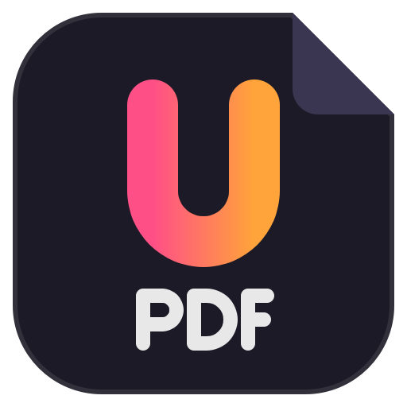
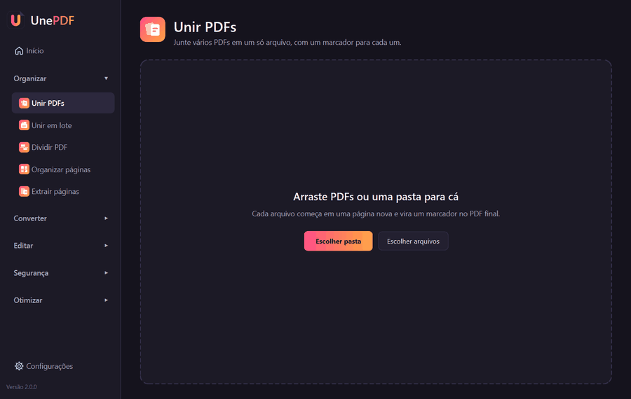
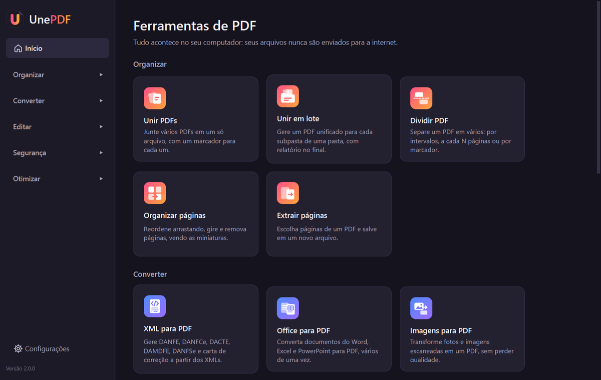
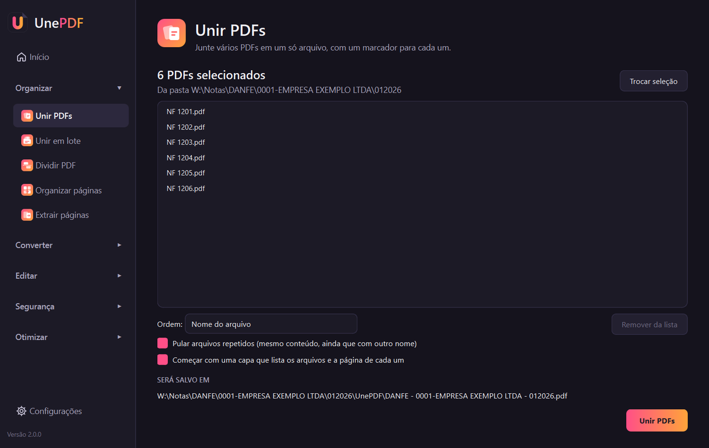
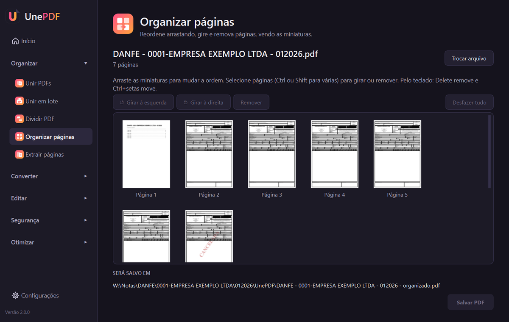
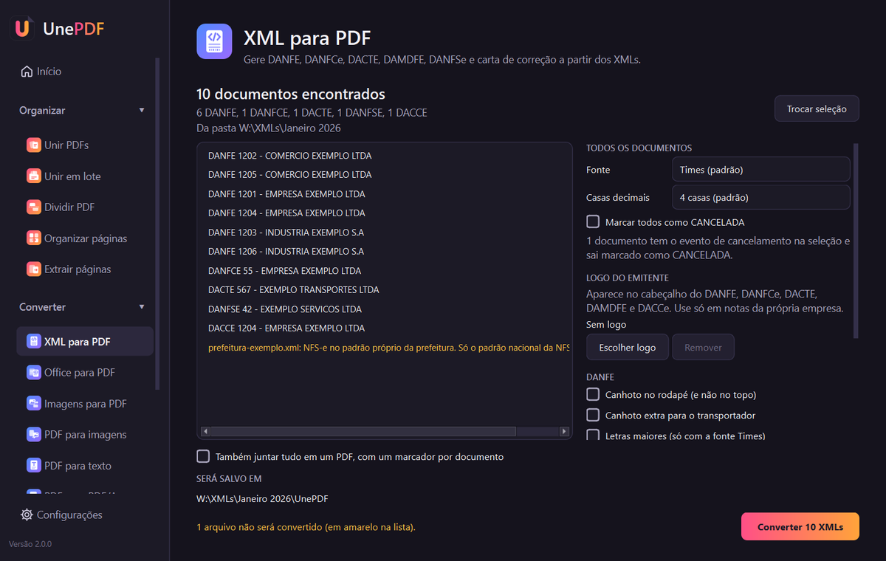
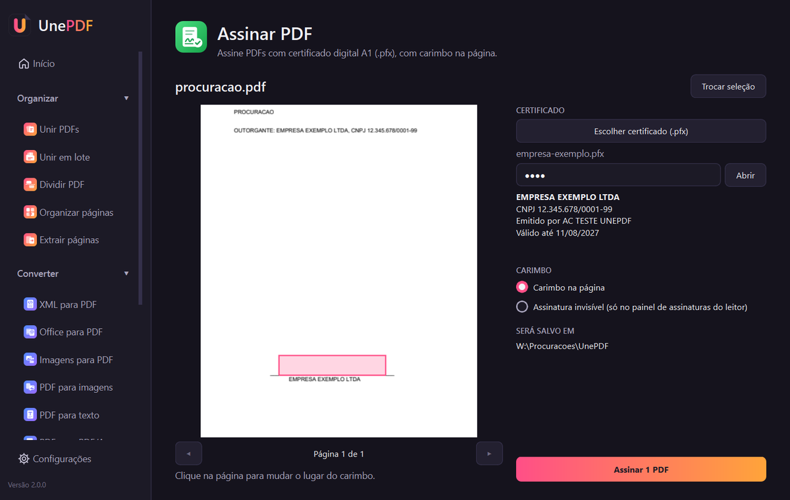

<p align="center">
  
</p>

<h1 align="center">UnePDF</h1>

<p align="center">
  Ferramentas de PDF para Windows, <strong>100% locais</strong>: os seus arquivos nunca saem do computador.
</p>

<p align="center">
  <a href="https://github.com/HigorPereira10/UnePDF/releases/latest"></a>
  <a href="https://github.com/HigorPereira10/UnePDF/actions/workflows/testes.yml"></a>
  
  <a href="LICENSE"></a>
</p>

<p align="center">
  <a href="https://github.com/HigorPereira10/UnePDF/releases/latest"><strong>Baixar o UnePDF</strong></a>
  ·
  <a href="#english">English</a>
</p>

<p align="center">
  
</p>

O UnePDF nasceu para resolver um problema do dia a dia de escritório: juntar em um único PDF dezenas ou
centenas de documentos que chegam em arquivos separados, como notas fiscais. Hoje ele reúne as
ferramentas de PDF mais usadas, no estilo dos sites de PDF, mas rodando no próprio computador: sem
cadastro, sem limite de arquivos e sem enviar documentos de clientes para servidor nenhum. Foi feito para
aguentar uso diário com muitos arquivos, inclusive em pastas de rede.

## Instalação

Baixe a versão mais recente na página de [versões](https://github.com/HigorPereira10/UnePDF/releases/latest):

- **`UnePDF-x.y.z-instalador.exe`**: instala só para o seu usuário, sem pedir administrador. Cria o
  atalho no Menu Iniciar, a entrada em "Adicionar ou remover programas" e o item "Unir com UnePDF" no
  botão direito do Explorer. O Ghostscript e o Tesseract vêm junto, como componentes que podem ser
  desmarcados;
- **`UnePDF-x.y.z-portatil.zip`**: extraia a pasta onde quiser e abra o `UnePDF.exe`, sem instalar.

Requer Windows 10 ou 11, de 64 bits.

> **"O Windows protegeu o computador"**: o instalador ainda não tem assinatura digital de código (um
> certificado pago), então o Windows mostra esse aviso na primeira vez. Clique em **Mais informações**
> e depois em **Executar assim mesmo**. O código-fonte de tudo o que vai no instalador está neste
> repositório.

Quando sai uma versão nova, o próprio UnePDF avisa na barra lateral. Para atualizar, basta rodar o
instalador novo por cima: as configurações são mantidas.

## Ferramentas

| Categoria | Ferramentas |
|---|---|
| Organizar | Unir PDFs, Unir em lote, Separar emitidas e recebidas (notas fiscais), Dividir PDF, Organizar páginas (reordenar, girar, remover) e Extrair páginas |
| Converter | XML para PDF (DANFE, DANFCe, DACTE, DAMDFE, DANFSe e carta de correção), Office para PDF (Word, Excel e PowerPoint), Imagens para PDF (sem perda de qualidade), PDF para imagens, PDF para texto e PDF para PDF/A (1b, 2b e 3b) |
| Editar | Marca d'água e Numerar páginas |
| Segurança | Proteger com senha (AES de 256 bits), Remover senha e Assinar PDF (certificado digital A1) |
| Otimizar | Comprimir PDF e OCR (deixa PDFs escaneados e imagens pesquisáveis) |

<p align="center">
  
</p>

## Seus arquivos não saem do computador

Todo o processamento acontece no próprio computador. O UnePDF só usa a internet em dois casos, e
nenhum deles envia documentos:

- **aviso de nova versão**: ao abrir, consulta a página de versões deste projeto no GitHub para saber
  se há uma versão mais nova (dá para desligar em Configurações);
- **Assinar PDF**: consulta a certificadora para confirmar que o certificado não foi revogado (sem
  internet, a assinatura é feita mesmo assim).

## Destaques

### Unir PDFs

Escolha uma pasta (ou arraste os arquivos para a janela) e o UnePDF gera um único PDF:

- cada arquivo começa em uma página nova e mantém todas as suas páginas;
- a ordem segue o nome do arquivo, tratando números como números (`2.pdf` vem antes de `10.pdf`);
  também dá para ordenar pela data de modificação ou arrastar os arquivos na lista;
- cada arquivo vira um marcador no PDF final, e a maioria dos leitores de PDF já abre com a lista de
  marcadores visível;
- opções para **pular arquivos repetidos** (mesmo conteúdo com nomes diferentes, como `nota.pdf` e
  `nota (1).pdf`) e para começar com uma **capa com índice**, com link para cada arquivo;
- arquivos vazios, corrompidos ou protegidos por senha são pulados sem interromper o processo, e no
  final o app lista quais foram e o motivo;
- os arquivos originais nunca são alterados nem apagados, e o resultado vai para a subpasta `UnePDF`.

O **Unir em lote** faz isso para muitas pastas de uma vez: a partir de uma pasta raiz, gera um unificado
para cada subpasta com PDFs, em qualquer nível, com um relatório no final.

<p align="center">
  
</p>

**Nome do arquivo final.** Por padrão é `<nome da pasta> - UNIFICADO.pdf`. Nas configurações dá para
ativar o perfil **Notas fiscais**, que reconhece pastas organizadas por tipo de documento, empresa e
competência:

```
C:\Notas\DANFE\0001-EMPRESA EXEMPLO LTDA\012026
    → UnePDF\DANFE - 0001-EMPRESA EXEMPLO LTDA - 012026.pdf
```

Os tipos reconhecidos são DANFE, DANFSE, DANFCE e DACTE, e a competência fica no formato `MMAAAA`.
Quando o nome da empresa tem uma barra (como em "S/S"), que o Windows transforma em várias pastas, as
partes são juntadas com hífen.

### Separar emitidas e recebidas

Para pastas de notas fiscais baixadas por sistemas de captura ou pelos portais, em que as notas de uma
empresa ficam todas juntas. Escolha a pasta do mês (ou várias) e o UnePDF move cada nota para a
subpasta do seu lado, criada dentro dela:

```
C:\Notas\DANFSE\0001-EMPRESA EXEMPLO LTDA\012026
    ├── PRESTADAS
    └── TOMADAS
```

- **quem emitiu** cada nota vem da chave de acesso, que traz o CNPJ do emitente e fica no nome do
  arquivo, no texto do PDF (DANFE, DANFCe, DACTE, DANFSe) ou no XML;
- **a empresa da pasta** é descoberta pelas próprias notas, sem cadastro: é o CNPJ que aparece em todas,
  ora como emitente, ora como destinatário ou tomador. Quando isso não basta (por exemplo, todas as
  notas do mês com o mesmo fornecedor), o app usa os outros meses, o CNPJ ou o nome da pasta e, por
  último, pergunta uma vez e guarda a resposta;
- **a mesma nota salva duas vezes** com nomes diferentes fica uma só: a cópia idêntica é apagada e uma
  versão diferente da mesma nota vai para `UnePDF\Repetidas`. Isso também resolve a nota que o sistema
  de captura grava de novo depois da separação;
- antes de mexer em qualquer arquivo, o app mostra a prévia de cada pasta. Notas que ele não consegue
  classificar com certeza ficam onde estão, com o motivo, e a separação pode ser **desfeita** depois;
- os nomes das subpastas mudam com o tipo de documento (EMITIDAS/RECEBIDAS, PRESTADAS/TOMADAS,
  EMITIDOS/RECEBIDOS) e podem ser trocados nas configurações;
- na prévia, ao lado do CNPJ escolhido aparece a linha da nota com o nome da empresa da pasta. Se o
  nome aparece junto de outro CNPJ, a pasta fica marcada com **Confira** antes de qualquer arquivo mudar
  de lugar;
- também dá para começar pelo Explorer: selecione as pastas dos meses, clique com o botão direito e
  escolha **Separar emitidas e recebidas (UnePDF)**.

Com o perfil Notas fiscais, unir a pasta do mês depois da separação gera um PDF para cada subpasta,
como `DANFSE - 0001-EMPRESA EXEMPLO LTDA - 012026 - PRESTADAS.pdf`.

### Unir com UnePDF, direto do Explorer

Selecione vários PDFs (ou uma pasta) no Explorer, clique com o botão direito e escolha **Unir com
UnePDF**: todos abrem juntos no Unir PDFs, sem limite de quantidade. No Windows 11, o item fica em
"Mostrar mais opções". Arrastar PDFs sobre o ícone do programa tem o mesmo efeito.

### Organizar páginas

Reordene arrastando as miniaturas, gire e remova páginas numa tela só. O Extrair páginas salva só as
páginas escolhidas em um novo arquivo.

<p align="center">
  
</p>

### XML para PDF

Gera o documento auxiliar de cada XML no leiaute oficial: DANFE (NF-e), DANFCe (NFC-e), DACTE (CT-e),
DAMDFE (MDF-e), DANFSe (NFS-e do padrão nacional) e DACCe (carta de correção da NF-e). O tipo de cada
arquivo é reconhecido pelo conteúdo, então uma pasta pode ter tipos misturados.

- cada PDF recebe o nome do documento, como `DANFE 1234 - EMPRESA EXEMPLO LTDA (XML).pdf`;
- se a seleção tiver o XML do evento de cancelamento de uma nota, o PDF dela sai marcado como CANCELADA;
- a carta de correção usa o nome e o endereço do emitente da NF-e, quando o XML da nota está junto;
- opcionalmente, todos os documentos também são juntados em um único PDF;
- dá para ajustar a fonte, as casas decimais, a logo do emitente, a posição do canhoto e outros detalhes;
- XMLs que não geram PDF (NFS-e no padrão próprio de uma prefeitura, resumos de nota, arquivos
  corrompidos) aparecem na lista com o motivo.

O desenho dos documentos é feito pela biblioteca
[BrazilFiscalReport](https://github.com/Engenere/BrazilFiscalReport).

<p align="center">
  
</p>

### Assinar PDF

Assina PDFs com certificado digital A1 (arquivo `.pfx`), no padrão PAdES, aceito pelo
[validador do ITI](https://validar.iti.gov.br). Serve tanto para o certificado do escritório quanto para o
de um cliente que autorizou alguém a assinar por ele.

- antes de assinar, o app mostra o titular, o CNPJ ou CPF, a certificadora e a validade do certificado,
  recusa certificado vencido e avisa quando o CNPJ do certificado não aparece no documento (para não
  assinar com o certificado do cliente errado);
- o carimbo fica sobre a última linha de assinatura do documento, e um clique na prévia da página muda
  o lugar; também dá para assinar sem carimbo;
- vários PDFs do mesmo titular podem ser assinados de uma vez;
- a senha do certificado nunca é guardada;
- cada assinatura é anotada num registro local (data, hora, arquivo, titular e usuário do Windows), que
  abre no Excel pelas configurações.

<p align="center">
  
</p>

### OCR

Deixa pesquisáveis os PDFs escaneados e as fotos de documentos: o texto reconhecido entra como uma
camada invisível por cima da imagem de cada página, então a aparência e o tamanho do arquivo quase não
mudam. Páginas que já têm texto ficam como estão. Reconhece português e inglês.

### Office para PDF

Converte documentos do Word, do Excel e do PowerPoint em lote, usando o Microsoft Office instalado, sem
abrir nenhuma janela e sem mexer nos documentos que você estiver editando. Sem o Office, usa o
LibreOffice. Opção de salvar em PDF/A.

## Programas externos

Algumas ferramentas usam programas gratuitos e separados do UnePDF. Sem eles, todas as outras
funcionam normalmente; as que dependem deles aparecem com a explicação do que falta.

| Programa | Usado em | Como conseguir |
|---|---|---|
| [Ghostscript](https://ghostscript.com/) | PDF para PDF/A, compressão forte e PDF/A no Office para PDF | Vem com o instalador e com o `.zip` |
| [Tesseract](https://github.com/tesseract-ocr/tesseract) | OCR e leitura de páginas escaneadas no PDF para texto | Vem com o instalador e com o `.zip` |
| Microsoft Office ou [LibreOffice](https://www.libreoffice.org/) | Office para PDF | Usa o que estiver instalado no computador |

Rodando pelo código-fonte, instale o Ghostscript pela
[página de downloads](https://ghostscript.com/releases/gsdnld.html) e o Tesseract pela versão da
[UB Mannheim](https://github.com/UB-Mannheim/tesseract/wiki), marcando **Portuguese** em "Additional
language data". O UnePDF encontra os dois sozinho.

O Excel monta as páginas a partir de uma impressora. Para não depender da impressora padrão (que pode
estar desligada ou ser de rede), o UnePDF usa a impressora "Microsoft Print to PDF", que vem com o
Windows, só dentro da cópia do Excel que ele abriu. A impressora padrão do Windows não muda.

## Onde ficam os dados do app

| O quê | Onde |
|---|---|
| Configurações | `%APPDATA%\UnePDF\config.json` |
| Registro de atividades (log) | `%LOCALAPPDATA%\UnePDF\logs` |
| Registro de assinaturas | `%LOCALAPPDATA%\UnePDF\logs\assinaturas.csv` |

Se o arquivo de configurações for apagado ou estiver corrompido, o app volta para os valores padrão.

## Para desenvolvedores

### Rodando pelo código-fonte

Requer Windows e [Python](https://www.python.org/downloads/) 3.11 ou superior.

```bat
git clone https://github.com/HigorPereira10/UnePDF.git
cd UnePDF
py -m venv .venv
.venv\Scripts\activate
py -m pip install -r requirements-dev.txt
py -m unepdf
```

Para rodar os testes: `py -m pytest`. Os testes que dependem do Ghostscript, do Tesseract ou do Office
são pulados quando o programa não está instalado.

### Gerando o executável e o instalador

- `scripts\build.bat`: roda os testes e gera o executável em `dist\UnePDF`;
- `scripts\distribuir.bat`: faz o mesmo e ainda gera o instalador e o `.zip` portátil. Precisa do
  Ghostscript, do Tesseract (com o português) e do [Inno Setup 6](https://jrsoftware.org/isdl.php).

A cada envio para o GitHub, os testes rodam automaticamente. Para publicar uma versão, ajuste
`__version__` em `unepdf/__init__.py` e envie a tag correspondente (`git tag v2.1.0` e
`git push origin v2.1.0`): o instalador e o `.zip` são gerados e a versão é criada em Releases como
rascunho, para conferir e publicar.

### Estrutura do projeto

```
unepdf/
  core/      regras de cada ferramenta, sem nenhuma dependência da interface
  ui/        interface gráfica em PySide6
  utils/     integração com o Windows, caminhos e logs
tests/       testes automatizados (PDFs, XMLs e certificados de teste são gerados na hora)
tools/       scripts de apoio ao build (ícones, licenças, programas externos, .zip)
scripts/     geração do executável e do instalador
instalador/  roteiro do instalador (Inno Setup)
assets/      logo e ícones
docs/        imagens deste README
```

## Contribuindo

Encontrou um problema ou tem uma sugestão? Abra uma
[issue](https://github.com/HigorPereira10/UnePDF/issues). Se o app mostrar uma mensagem de erro, o
botão "Copiar detalhes do erro" copia as informações técnicas que ajudam a investigar. Para contribuir
com código, veja o [CONTRIBUTING.md](CONTRIBUTING.md).

## English

**UnePDF** is a free, open source PDF toolkit for Windows that runs **entirely on your computer**: files
are never uploaded anywhere. It was born in an accounting office to merge hundreds of invoices into a
single PDF, and grew into a full set of everyday PDF tools:

- **Organize**: merge PDFs (also one merged file per subfolder, in batch), sort a folder of Brazilian
  invoices into issued and received (by the CNPJ in the access key, with no customer list), split,
  reorder, rotate, remove and extract pages with thumbnails;
- **Convert**: Brazilian electronic invoice XML to PDF (DANFE, DANFCe, DACTE, DAMDFE, DANFSe and
  correction letters), Word, Excel and PowerPoint to PDF, images to PDF and back, PDF to text and PDF to
  PDF/A;
- **Edit**: watermark and page numbers;
- **Security**: password protection (AES-256), password removal and digital signatures with A1
  certificates (`.pfx`), in the PAdES standard;
- **Optimize**: compression and OCR (searchable PDFs from scans, in Portuguese and English).

Download the installer or the portable `.zip` from the
[releases page](https://github.com/HigorPereira10/UnePDF/releases/latest) (Windows 10 or 11, 64-bit).
The installer is not code-signed yet, so Windows SmartScreen may show a warning: click **More info**
and then **Run anyway**. The interface is in Brazilian Portuguese.

The only network access is an optional check for new versions on GitHub and, when signing, the
certificate revocation check with the certificate authority. Documents are never sent.

## Licença

O UnePDF é software livre, distribuído sob a [licença MIT](LICENSE). As bibliotecas e os programas
usados, com as suas licenças, estão em [THIRD_PARTY_LICENSES.md](THIRD_PARTY_LICENSES.md).
